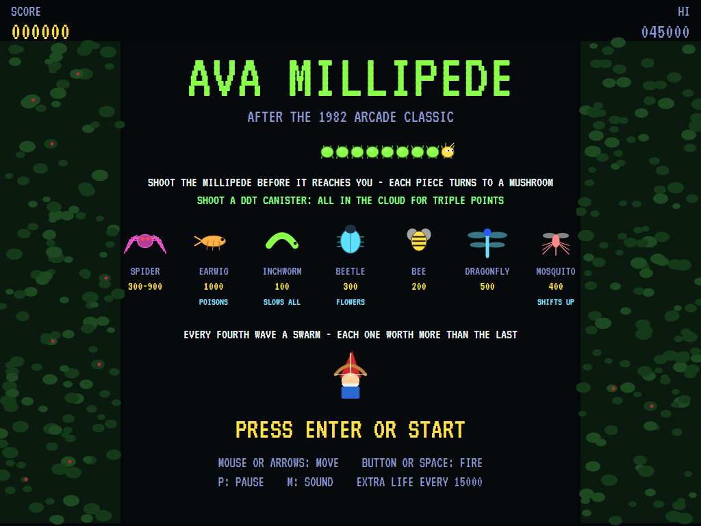
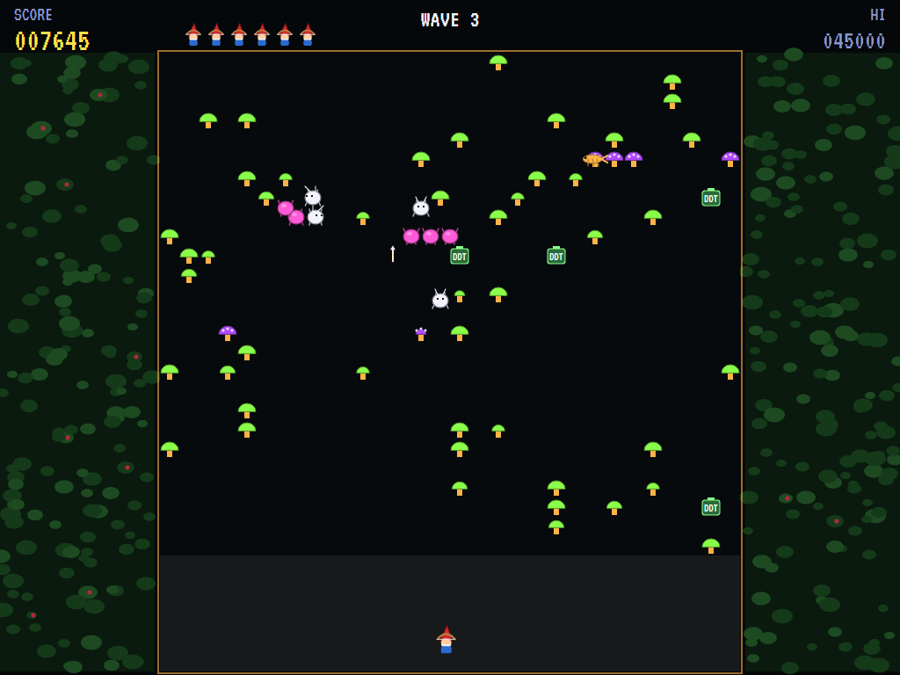
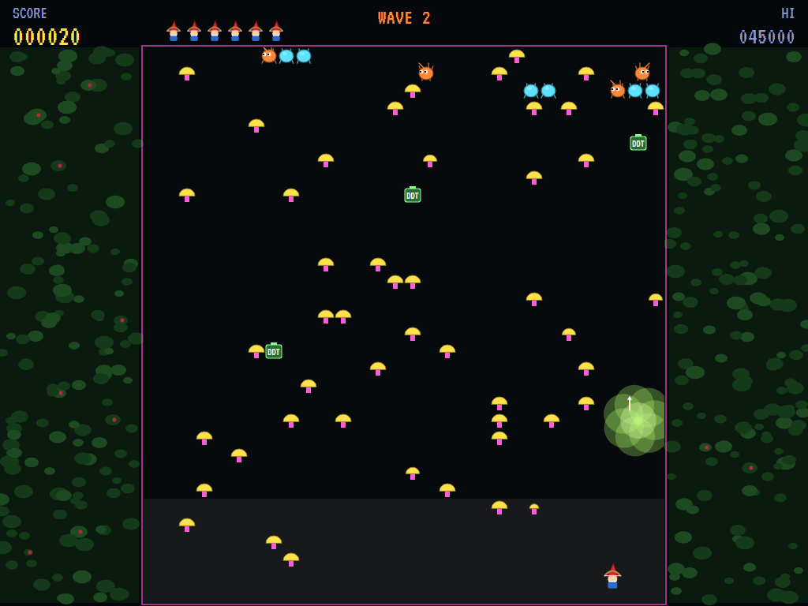
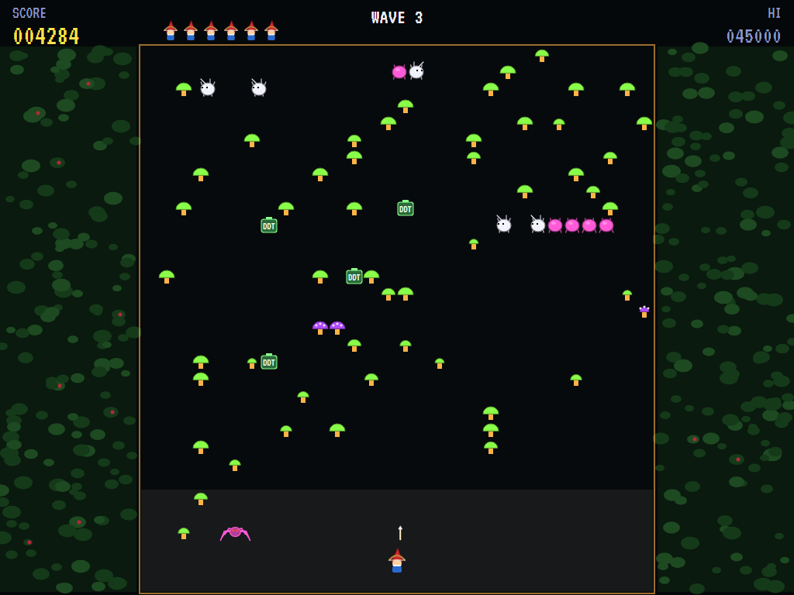
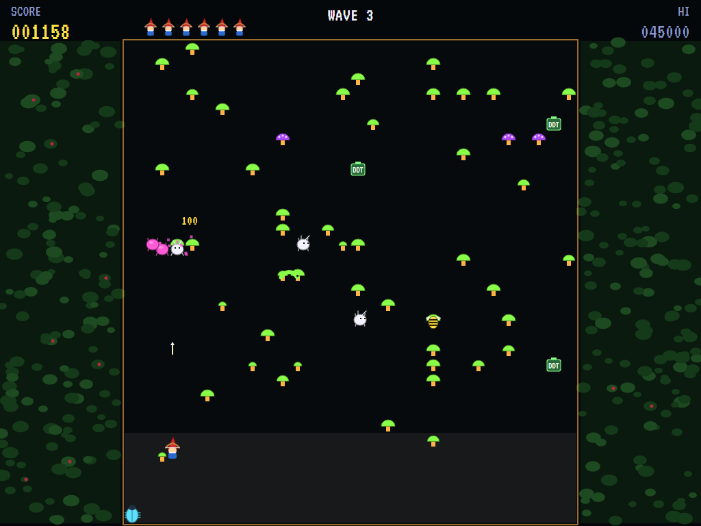
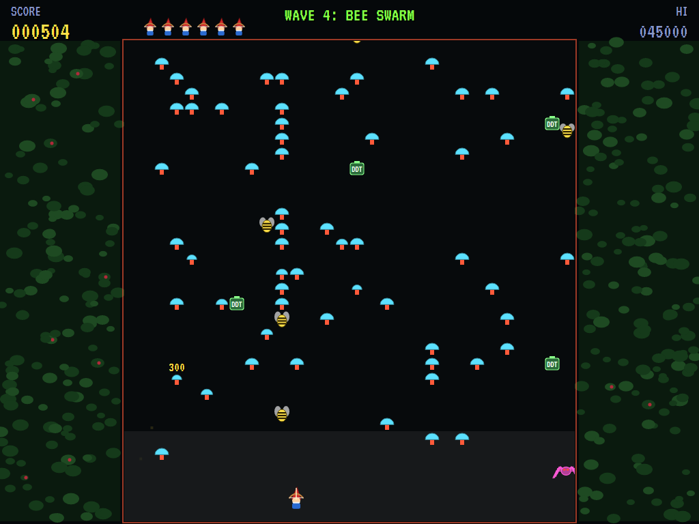
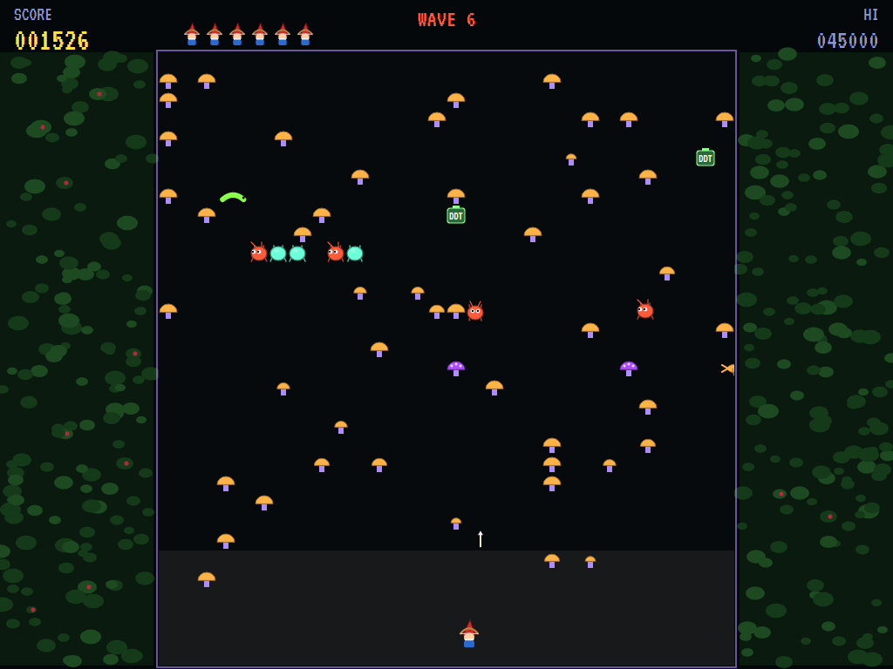
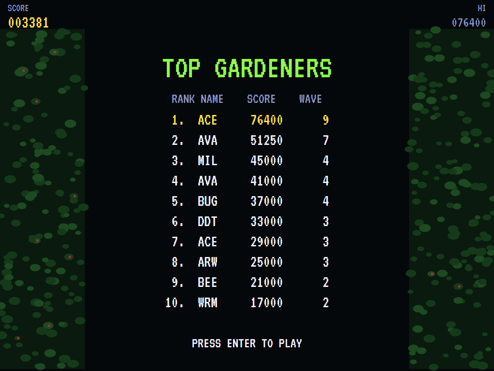

# AVA Millipede

[](https://github.com/Harlock123/AVAMillipede/actions/workflows/build.yml)

A garden shooter in the style of Atari's 1982 arcade game **Millipede**, built with .NET 10 and Avalonia UI.
A gnome archer guards the bottom of a garden while a millipede winds down through the mushrooms towards it.
Every piece you shoot turns into another mushroom. Shoot a DDT canister when the millipede is near it and the
cloud takes everything inside for triple points. Meanwhile the bugs come: a spider that bounces about your
patch, earwigs that poison the mushrooms, inchworms, beetles, bees, dragonflies and mosquitoes, each with a
trick of its own.

## Features

- **The garden**: thirty columns of mushrooms, four hits each, with the archer's patch along the bottom.
  Each wave the garden takes on new colours and shifts down a row.
- **The archer**: moves about its patch, by mouse (like the arcade's trackball), keys or gamepad. It fires
  one arrow at a time, very fast; hold the button and another goes as soon as the last is spent.
- **The millipede**: twelve segments winding down. At a wall or a mushroom it drops a row and turns, works
  through your patch and back up it. Shoot a segment and it becomes a mushroom, and the segment behind
  becomes a head (100; body segments 10). From the second wave, some of it comes in as single heads, and more
  heads join from the sides once it has reached your patch.
- **DDT**: four canisters in the garden. Shoot one and its cloud kills whatever is in it, for triple points.
  Don't stand in it yourself.
- **The bugs**:
  - **Spider** (300 to 900, more the closer it is shot): bounces about your patch eating mushrooms.
  - **Earwig** (1000): scuttles across, poisoning the mushrooms it passes. The millipede dives through
    poisoned ones.
  - **Inchworm** (100): shoot it and everything slows down for a while.
  - **Beetle** (300): comes down a side, along the bottom and up the other side, turning mushrooms to flowers
    the arrows can't touch. Shoot it and the whole garden shifts down a row.
  - **Bee** (200) and **dragonfly** (500): drop through the garden leaving new mushrooms.
  - **Mosquito** (400): bounces down at an angle. Shoot it and the garden shifts back up a row.
- **Swarms**: every fourth wave there's no millipede, but a swarm of bees, then dragonflies, then mosquitoes,
  each one worth a hundred more than the last, up to 1000.
- **Losing a life**: the damaged mushrooms, poisoned ones and flowers are mended one by one, five points each,
  and what's left of the millipede starts again from the top. An extra life every 15000.
- **The attract mode** plays itself: a computer archer that dodges the spider and segments, steps out of
  the beetle's way, sets off the DDT when the millipede comes near, and otherwise goes for the lowest head.
- **The sounds** are all synthesised: the arrow, every kind of hit, the DDT's hiss, the bugs, the millipede's
  creeping beat and a garden tune for the title.

## Screenshots

| The title | The millipede | DDT |
|:---------:|:-------------:|:---:|
|  |  |  |
| The bugs, and what they do. | Broken up, heads everywhere. | The cloud going off. |

| The spider | A beetle, and poisoned mushrooms | A swarm |
|:----------:|:--------------------------------:|:-------:|
|  |  |  |
| Bouncing into the patch. | Coming along the bottom. | Bees, each worth more. |

| Wave six | The high scores | |
|:--------:|:---------------:|:-:|
|  |  | |
| New colours every wave. | The top gardeners. | |

The screenshots are made by the tests, which play the game in a real (headless) window; see
[Tests](#tests).

## Download and run

Ready-to-run builds for Windows, macOS and Linux, on both Intel/AMD and ARM, are on the
[Releases page](https://github.com/Harlock123/AVAMillipede/releases/tag/latest). **Latest build** is
rebuilt on every push to `main`. Each download is one self-contained executable: no .NET install is
needed.

| Platform | Archive |
|---|---|
| Windows | `AVAMillipede-win-x64.zip`, `AVAMillipede-win-x86.zip`, `AVAMillipede-win-arm64.zip` |
| macOS | `AVAMillipede-osx-arm64.tar.gz` (Apple silicon), `AVAMillipede-osx-x64.tar.gz` (Intel) |
| Linux | `AVAMillipede-linux-x64.tar.gz`, `AVAMillipede-linux-arm64.tar.gz`, `AVAMillipede-linux-arm.tar.gz` |

```bash
tar -xzf AVAMillipede-linux-x64.tar.gz     # or linux-arm64, linux-arm, osx-arm64, osx-x64
./AVAMillipede
```

On Windows, unzip and run `AVAMillipede.exe`. On macOS, if Gatekeeper refuses to open it, run
`xattr -d com.apple.quarantine AVAMillipede` once. Run with `--no-audio` for silence.

**Sound** comes through OpenAL Soft, built in for every platform. In a virtual machine the game
detects it and uses a larger audio buffer, so the sound doesn't break up.

**Gamepads** use SDL2, which is bundled for Windows, macOS and Intel/AMD Linux. ARM Linux builds need it
installed; without it the keyboard still works:

```bash
sudo apt install libsdl2-dev            # Debian / Ubuntu / Raspberry Pi OS
sudo pacman -S --needed sdl2-compat     # Arch / Omarchy
```

## Controls

| Input | Action |
|-------|--------|
| **Enter** | Start |
| **Arrow keys** / **W A S D** | Walk (diagonals too) |
| **Space** / **Z** / **X** / **Ctrl** | Shoot an arrow, the way you last walked (in a room) |
| **P** / **Esc** | Pause (Esc again to quit) |
| **M** | Mute |
| **Ctrl+S** / **Cmd+S** | Save a screenshot to the Pictures folder |

**Gamepad**: left stick or D-pad to walk, **A**, **B**, **X** or the right trigger to shoot, **Start** to
start and pause, **Back** (while paused) to quit.

**Entering initials**: type letters, or dial with **Up**/**Down** and accept with **Space**; **Left** /
**Backspace** go back; **Enter** finishes.

## Controls

| Action | Mouse | Keyboard | Gamepad |
|---|---|---|---|
| Move | Move (the archer follows) | Arrows / WASD | Left stick / D-pad |
| Fire (hold for more) | Left button | Space, Z, X or Ctrl | A, B, X or right trigger |
| Start | | Enter | Start |
| Pause | | P or Esc | Start |
| Sound on/off | | M | |
| Screenshot | | Ctrl+S (to your Pictures folder) | |

On the high-score table, type your initials, or use up/down and Space, then Enter.

## Tests

```bash
dotnet test AVAMillipede.slnx
```

The engine has no UI and runs in fixed 60 Hz steps, so it plays the same at any frame rate, and a seed
always plays the same game. The tests check:

- **The archer:** its patch, mushrooms in the way, the mouse, one arrow at a time, and mushrooms taking four hits
- **The millipede:**
  - its turns at mushrooms
  - shot segments becoming mushrooms and new heads
  - diving through poisoned mushrooms
- **DDT:** the cloud and its triple points
- **The bugs:**
  - the spider's points by distance
  - earwigs poisoning, and beetles' flowers that arrows can't hurt
  - the inchworm's slow-down
  - the garden shifting down for the beetle and up for the mosquito
  - bees seeding mushrooms
  - swarms and their rising points
- **Losing and winning:**
  - mending after a life is lost, and the last life
  - the next wave's shift and colours
  - DDT topped up
  - extra lives
- **The machine:** the attract cycle, the computer archer clearing the first wave, the same game from the same seed, and pausing

The screenshot tests draw the real screen in a headless window. To refresh the README's pictures:

```bash
MILLIPEDE_SHOTS=$PWD/Images dotnet test tests/AVAMillipede.Tests --filter ScreenshotTests
```

To see how the computer archer gets on, wave by wave (for tuning):

```bash
MILLIPEDE_PROBE=1 dotnet test tests/AVAMillipede.Tests --filter PilotProbe --logger "console;verbosity=detailed"
```

## Building

```bash
dotnet build AVAMillipede.slnx
dotnet run --project src/AVAMillipede
```

Needs the .NET 10 SDK. The sounds are made by `tools/make_sounds.py` (standard-library Python):
`python3 tools/make_sounds.py` rewrites `src/AVAMillipede/Sounds`.

## Project structure

```
AVAMillipede/
├── AVAMillipede.slnx
├── src/AVAMillipede/
│   ├── Engine/
│   │   ├── GameEngine.cs        # States, the title and demo cycle, and the millipede's beat
│   │   ├── GameEngine.Play.cs   # The garden, the archer and its arrows, the millipede, DDT, the bugs,
│   │   │                        # swarms, mending; waves and scoring
│   │   ├── ShipPilot.cs         # The computer archer, for the demonstration (and the tests)
│   │   ├── Entities.cs          # The garden's grid, its plots, the segments, the bugs and the clouds
│   │   ├── HighScoreTable.cs, InitialsEntry.cs
│   │   ├── InputHandler.cs, ControllerManager.cs  # Mouse, keys and an SDL2 gamepad
│   │   └── SoundManager.cs      # Effects and the tunes through OpenAL
│   ├── Audio/                   # The OpenAL engine (from the author's AVABand)
│   ├── Views/                   # The garden, its hedges, the millipede, the bugs and the screens
│   └── Sounds/                  # The synthesised effects and tunes
├── tests/AVAMillipede.Tests/    # Gameplay, screenshot and probe tests
├── tools/make_sounds.py
└── Images/                      # Screenshots
```

## About and licence

AVA Millipede © 2026 Lonnie Watson, under the [MIT License](LICENSE).

*Millipede* © 1982 Atari; the name belongs to its current owner. AVA Millipede is an independent, unofficial
game in its style. Its archer, its millipede and bugs, its garden, graphics, sounds, tunes and code are its
own; nothing is taken from the arcade machine's program, graphics, sound or music. It is not affiliated with
or endorsed by any rights holder.
